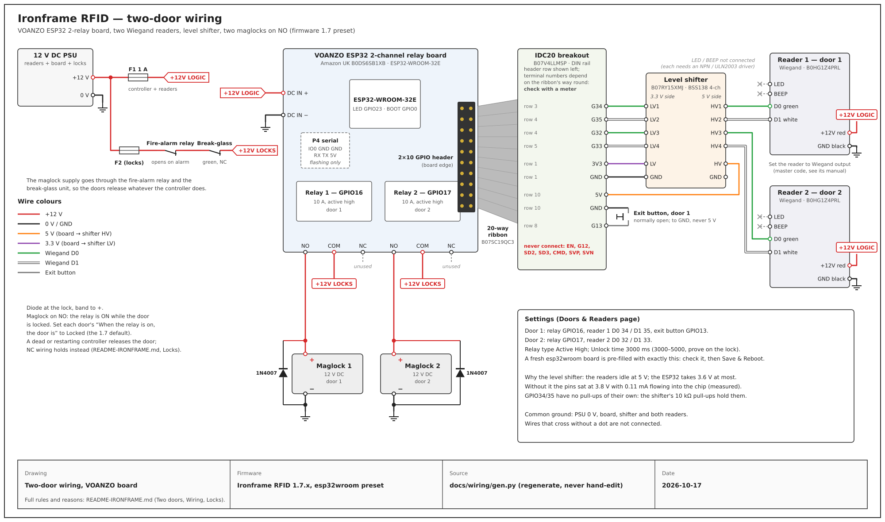

# Ironframe RFID — two-door access controller on an ESP32

Ironframe RFID is a door access controller: an ESP32 two-relay board, two Wiegand card/keypad readers and a web page you run it from. It is Ironframe's fork of [esp-rfid](https://github.com/esprfid/esp-rfid) (MIT), ported from the ESP8266 to the ESP32 / ESP32-S3, with its own phone-first web UI, per-door access, an access log that survives restarts, and a long list of security fixes.

> **Full install guide:** [README-IRONFRAME.md](README-IRONFRAME.md) — every pin, wiring rule, lock type, recovery step and residual risk. This page is the overview and the parts list. Where they differ, README-IRONFRAME.md is right (its claims are checked against the code by `test/check-docs.mjs`).
>
> **Not yet signed off for a door.** What has and hasn't been proven on the real board is at the top of README-IRONFRAME.md and in [docs/STATUS.md](docs/STATUS.md). Finish that bench test first.

## What it does

- **Two doors, one reader each** (or one door with an In and an Out reader). A card at reader 1 can only open door 1, and only if that user has door 1 access.
- **Cards, keypad PINs, or card + PIN**, from 26- or 34-bit Wiegand readers (125 kHz EM and 13.56 MHz MIFARE cards).
- **Exit button, door contact and doorbell** per door; door-left-open and tamper alarms.
- **Web UI** from any phone or laptop: users, per-door access, expiry dates, access and event logs, settings, backup and restore, firmware update. Most settings apply without a restart.
- **Works without a network.** The board keeps its own hotspot for setup; an optional DS3231/DS1307 RTC keeps the time through a power cut.
- **MQTT** for Home Assistant and similar ([README-MQTT.md](README-MQTT.md)).
- **Fails secure:** damaged or unsafe settings leave the relays locked and the readers off, while exit buttons still work.

## Parts

What this build uses (Amazon UK):

| Part | Qty | Listing | Notes |
|---|---|---|---|
| ESP32 2-channel relay board (VOANZO, ESP32-WROOM-32E, "ESP32 Relay X2") | 1 | [B0DS6SB1XB](https://www.amazon.co.uk/dp/B0DS6SB1XB) | DC 5-60 V input. Relay 1 = GPIO16, relay 2 = GPIO17 (10 A, COM/NO/NC). No USB: flashed through its 6-pin serial header. |
| Wiegand 26/34 RFID reader with keypad, 125 kHz + 13.56 MHz, IP68 | 2 | [B0HG1Z4PRL](https://www.amazon.co.uk/dp/B0HG1Z4PRL) | 9-16 V DC (use 12 V). Must be switched to **Wiegand output** mode with its master code (see *Reader setup* in the guide). |
| 20-way IDC ribbon cable, FC/FC, 2.54 mm, 30 cm | 1 | [B07SC19QC3](https://www.amazon.co.uk/dp/B07SC19QC3) | Board's 2×10 GPIO header → breakout. |
| IDC20 male header → screw terminal breakout, DIN-rail bracket | 1 | [B07V4LLMSP](https://www.amazon.co.uk/dp/B07V4LLMSP) | Every reader wire lands here. Check which terminal is which pin with a meter: it depends on the ribbon's orientation. |
| 4-channel bi-directional logic level converter, 3.3 V ↔ 5 V (Gebildet, BSS138 type, pack of 10) | 1 | [B07RY15XMJ](https://www.amazon.co.uk/dp/B07RY15XMJ) | **Mandatory.** The readers' D0/D1 idle at about 5 V (measured 3.8 V and 0.11 mA into the ESP32 pin with no shifter, i.e. its protection diode conducting). One board does all four data lines: HV → 5V, LV → 3V3, GND → GND, HV1-4 ← reader 1 D0/D1 and reader 2 D0/D1, LV1-4 → GPIO 34/35/32/33. Solder its header pins, or 2.54 mm screw terminals, before use. |
| 3D-printed mounts for the relay board | — | — | Print files to be added. |

Also needed (not in the list above):

| Part | Why |
|---|---|
| ULN2003 board, or NPN transistors (BC547/2N2222 + 1 kΩ + 10 kΩ) | Drives the readers' LED and buzzer wires. |
| 2×10 pin header (box header) on the board | If the board's GPIO header holes arrived unpopulated. |
| 12 V DC supply, fused separately for the controller/readers and each lock | Powers board, readers and locks. |
| Lock (maglock or strike), 1N4007 flyback diode across each DC lock coil | Fitted at the lock. |
| Normally-open exit button per door (pin → GND, **never 5 V**) | GPIO13 for door 1. |
| Fire-alarm relay in the maglock's power | **A maglock must release without the controller.** |
| USB-serial adapter with 3.3 V logic (CP2102 / FT232R) | First flash only; later updates are over Wi-Fi. |
| Optional: DS3231 RTC module | Keeps the time with no internet (SDA 21, SCL 22). |

## 3D-printed mounts

The relay board sits on 3D-printed mounts. The print files will be added to this repository later.

## Wiring at a glance



The drawing is generated by `docs/wiring/gen.py` (`python3 docs/wiring/gen.py docs/wiring/wiring-two-door.svg`); change the script, never the SVG.

| Reader wire | Reader 1 / door 1 | Reader 2 / door 2 |
|---|---|---|
| +12 V (red) | 12 V | 12 V |
| GND (black) | GND (shared with the board) | same |
| D0 (green), via level shifter | GPIO 34 | GPIO 32 |
| D1 (white), via level shifter | GPIO 35 | GPIO 33 |
| LED, via driver | GPIO 25 | GPIO 27 |
| BEEP, via driver | GPIO 26 | GPIO 14 |
| Lock | relay 1 (GPIO 16) | relay 2 (GPIO 17) |
| Exit button (to GND) | GPIO 13 | GPIO 4, 18 or 19 |

A fresh board flashed with the `esp32wroom` image pre-fills exactly this. Never connect EN, G12, SD2, SD3 or CMD on the 2×10 header. Header rows, lock wiring (fail-secure strike, maglock on NO or NC) and the reasons for each rule: [README-IRONFRAME.md](README-IRONFRAME.md#two-doors-voanzo-esp32-2-relay-board--two-standalone-wiegand-readers).

## Getting the firmware

Releases are on GitHub: **https://github.com/rell666/esp32-rfid-door-controller/releases**. Each has four files:

| File | Use |
|---|---|
| `ironframe-rfid-<v>.bin` | Update over Wi-Fi from the web UI |
| `ironframe-rfid-<v>-full-flash.bin` | First flash over serial, at offset `0x0` |
| `ironframe-rfid-<v>-SHA256SUMS.txt` | Checksums |
| `ironframe-rfid-<v>-README.txt` | What changed |

Upstream esp-rfid release files are ESP8266 builds and will not run on this board.

### First flash (once, over serial)

The board has no USB port. Wire a 3.3 V USB-serial adapter to its 6-pin header (**not** FTDI order — read the labels): adapter TX → board RX, RX → TX, GND → GND, IO0 → GND. Power the board from its own supply; **don't** connect the adapter's VCC (the header's power pin is 5 V). Then:

```sh
esptool.py --chip esp32 --port /dev/ttyUSB0 write_flash --erase-all 0x0 ironframe-rfid-<v>-full-flash.bin
```

Remove IO0 from GND and power-cycle. After that, update from **Update** in the web UI.

### First boot

1. Join the Wi-Fi hotspot `IRONFRAME-RFID-xxxxxx` (password `ironframe-setup`) and open `http://192.168.4.1`.
2. Sign in with `admin`; you are made to set a new admin password (8-64 characters).
3. Check **Doors & Readers**, set Wi-Fi, then **Save & Reboot**.
4. **Users**: scan a card at a reader, name it, tick the doors it may open.

## Building from source

```sh
pio run -e esp32wroom          # VOANZO board → bin/esp32wroom.bin + bin/esp32wroom-full.bin
pio run -e esp32s3             # ESP32-S3 DevKitC → bin/esp32s3.bin + bin/esp32s3-full.bin
bash test/all.sh               # every gate: builds, unit tests, QEMU, UI end-to-end, docs
```

After changing anything under `src/websrc`, rebuild the web UI: `cd tools/webfilesbuilder && npm ci && node bin.js`. More in [CONTRIBUTING.md](CONTRIBUTING.md).

## Safety and security

- **A maglock is fail-released only if wired that way, and must have an emergency release that does not depend on this controller** (a fire-alarm relay). Get the door's fire safety signed off.
- Card UIDs can be cloned; there is no TLS on the web UI or MQTT; firmware is not signed and flash is not encrypted. Keep it on a trusted network. The full list is in [README-IRONFRAME.md § Residual risks](README-IRONFRAME.md#residual-risks-not-fixed-know-these-before-deploying).

## Documents

| File | What |
|---|---|
| [README-IRONFRAME.md](README-IRONFRAME.md) | Install guide: hardware, wiring, locks, flashing, recovery, what changed, risks |
| [README-MQTT.md](README-MQTT.md) | MQTT topics and commands |
| [CHANGELOG.md](CHANGELOG.md) | Every release |
| [docs/STATUS.md](docs/STATUS.md) | What has been proven on real hardware, and what has not |
| [docs/evidence/RELEASES.md](docs/evidence/RELEASES.md) | Every release: gates and image checksums |

## Credits and licence

Based on [esp-rfid](https://github.com/esprfid/esp-rfid) by the esp-rfid contributors (MIT; see [LICENSE](LICENSE)). The ESP8266 code is gone: at 1.7.0 about 8 % of the lines (2,020 of 25,645, by `git blame` against the fork point `0b2c57f`, generated web files excluded) are still upstream's, mostly MQTT, Wi-Fi, LED and beeper code. Third-party libraries keep their own licences.
