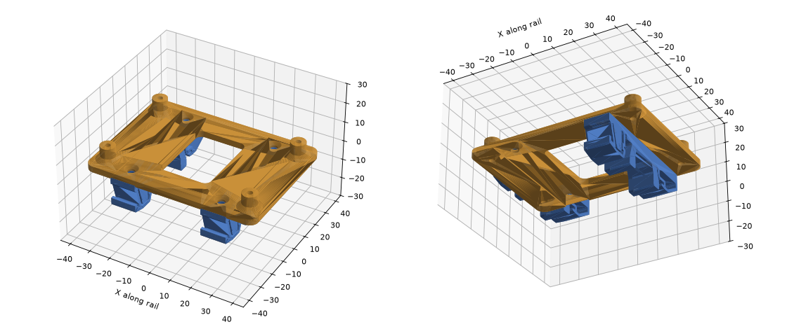

# DIN-rail plate for the VOANZO ESP32 2-relay board

A 3D-printed plate that holds the VOANZO board on a 35 mm DIN rail, for mounting in a panel.

- `esp32_din_plate.stl`: the plate to print, 82 x 60 x 3 mm with four 7 mm standoffs on the board's mounting holes (69 x 43 mm centre to centre). The top-left standoff only supports the board, because the board has no hole there. The standoffs have 2.6 mm pilot holes for M3 self-tapping screws.
- `plate.py`: the script that makes the STL (Python with `manifold3d`, `numpy` and `trimesh`). Change the sizes at the top and run it again: `python3 plate.py`.
- `dins_clip.stl`: the DIN-rail clip; print **two**. It is "Din rail clip" by Bryan, [Printables model 64242](https://www.printables.com/model/64242-din-rail-clip), public domain (CC0), copied unchanged. Screw the two clips to the underside of the plate with M3 (or 3.5 mm) countersunk screws: the plate has countersunk holes 46 mm apart for each clip and shallow pockets that locate the clip tops. With it here, `plate.py` also writes `preview.glb`, the plate with both clips in place.

## Printed with

Both parts: PrusaSlicer 2.9.6, PLA, 0.3 mm nozzle, 0.15 mm layers, 4 perimeters, 6 top and 5 bottom layers, 40 % gyroid infill, no supports, 220 °C nozzle, 65 °C bed (an i3 Pro C, 2026-10-13). Print it flat, the standoffs up.
